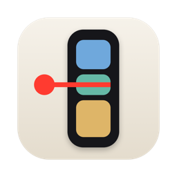

<p align="center">
  
</p>

<h1 align="center">Todaytape</h1>

<p align="center">Today's Google Calendar as a slim strip on the edge of your Mac screen, with a red line at <em>now</em>.</p>

<p align="center">
  <a href="https://github.com/ProximoBinks/todaytape/releases/latest"><b>Download for Mac</b></a> ·
  <a href="https://todaytape.vercel.app">Website</a> ·
  <a href="docs/google-setup.md">Google setup guide</a>
</p>

---

Reminders fire once and calendar tabs get buried. Todaytape keeps the shape of your day in view while you work: what's on now, what's next and how long you have, without opening anything.

- **A tape that stays put.** Always on top, on every Space and over full-screen apps. It never takes focus, so you keep typing.
- **Collapsed or expanded.** Slim colour blocks while you work. Right-click for titles and times, with the current time riding the red line.
- **Sized to your day.** Blocks are as long as the events; gaps are free time. The tape runs from your first event to your last.
- **One click to join.** Click a block to open its Google Meet, Zoom, Teams, Webex or Whereby link.
- **Countdown in the menu bar.** Minutes left in the current event, or until the next one.
- **Your colours.** Pick a colour per calendar; text stays readable and finished events fade.
- **Private by design.** Read-only, and it talks to Google directly with a client you own. There's no Todaytape server, account or analytics.

Requires macOS 14 Sonoma or later and a Google account.

## Install

1. Download **Todaytape-x.y.z.zip** from the [latest release](https://github.com/ProximoBinks/todaytape/releases/latest) and unzip it.
2. Drag **Todaytape.app** into **Applications**.
3. Open it (see the note below the first time).

### Opening Todaytape for the first time

Todaytape is free and open source, and isn't notarised by Apple yet, so macOS asks you to confirm once:

1. Double-click **Todaytape**. macOS says it can't verify the developer. Click **Done** (or **Cancel**).
2. Open **System Settings → Privacy & Security**, scroll down to the message about Todaytape, and click **Open Anyway**. Confirm with your password or Touch ID.

Or, in Terminal: `xattr -dr com.apple.quarantine /Applications/Todaytape.app`

Prefer not to run a downloaded binary? [Build it yourself](#build-from-source); it takes about a minute.

## Connect your Google Calendar

The first time you open Todaytape, a **Set up Todaytape** window walks you through three steps, with a button for each Google page:

1. **Prepare a Google Cloud project:** create a project, enable the Calendar API, and add yourself as a test user.
2. **Add your Desktop client:** create a Desktop app client, download its JSON, and click **Import client JSON…**
3. **Connect Google Calendar:** sign in through your browser.

It takes about 5 minutes, once. The [Google setup guide](docs/google-setup.md) has every click and a troubleshooting table.

**Why do I need my own Google client?** Apps that read Gmail or Calendar data must pass Google's verification before anyone can sign in to a shared client. With your own client, your calendar goes straight from Google to your Mac, and nobody else can use it or see your data. The trade-off: while your client is in Testing, Google signs you out every 7 days, and you click **Connect** again.

## Use

| | |
|---|---|
| Tape | Right edge of the screen, on top of every app and Space |
| Right-click the tape | Expand or collapse |
| Click a block | Join the call, or open the event in Google Calendar |
| Menu bar icon | Countdown, plus Expand, Hide, Refresh, Settings and Quit |
| Hide | Tucks the tape into a small tab at the screen edge; click the tab to bring it back |
| Settings (⌘,) | Calendars and their colours, dark or light, open at login, Google account |

## Privacy

- Todaytape requests one permission: `calendar.readonly`. It can't create, edit or delete events.
- Your Mac talks to Google directly. Nothing is sent anywhere else.
- Your client, sign-in and settings live in `~/.todaytape`, readable only by your user account.
- **Disconnect** in Settings signs out and asks Google to revoke access. **Remove client** also forgets the client ID and secret.

## Build from source

You need the Command Line Tools (`xcode-select --install`). Xcode is optional.

```sh
git clone https://github.com/ProximoBinks/todaytape.git
cd todaytape
./build.sh --install
```

That builds `build/Todaytape.app`, copies it to Applications and opens it. Other options:

```sh
./build.sh               # build only
./build.sh --release     # Apple silicon + Intel, plus a zip in build/
./scripts/test.sh        # run the tests
```

Command-line helpers, for debugging:

```sh
/Applications/Todaytape.app/Contents/MacOS/Todaytape --dump     # print today's events
/Applications/Todaytape.app/Contents/MacOS/Todaytape --logout   # forget the Google sign-in
/Applications/Todaytape.app/Contents/MacOS/Todaytape --version
```

Set `TODAYTAPE_HOME=/some/folder` to run with a separate config folder, for example to try the first-run setup without touching your own.

### Project layout

```
Sources/Todaytape/
  TodaytapeApp.swift         menu bar extra and command-line helpers
  AppState.swift             setup phases, sync, settings
  OverlayController.swift    the always-on-top panel and Settings window
  OverlayView.swift          the tape: layout, expand animation, now line
  SettingsView.swift         first-run setup and Settings
  GoogleAuth.swift           OAuth: loopback redirect, PKCE, state check
  GoogleCalendar.swift       Calendar API
  Config.swift               ~/.todaytape files
  CalendarColor.swift        palette, past-event fade, text contrast
Tests/TodaytapeTests/        self-checking tests (scripts/test.sh)
docs/google-setup.md         the step-by-step Google guide
site/                        the website (static HTML)
```

## Contributing

Issues and pull requests are welcome. Run `./scripts/test.sh` before you open a PR, and never commit a client secret, `credentials.json` or `tokens.json`.

## Star History

<a href="https://www.star-history.com/?type=date&amp;repos=ProximoBinks%2Ftodaytape">
  <picture>
    <source media="(prefers-color-scheme: dark)" srcset="https://api.star-history.com/chart?repos=ProximoBinks/todaytape&amp;type=date&amp;theme=dark&amp;legend=top-left" />
    <source media="(prefers-color-scheme: light)" srcset="https://api.star-history.com/chart?repos=ProximoBinks/todaytape&amp;type=date&amp;legend=top-left" />
    
  </picture>
</a>

## License

[MIT](LICENSE) © 2026 Elliot Koh
